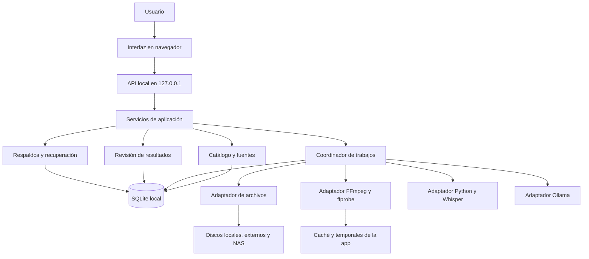
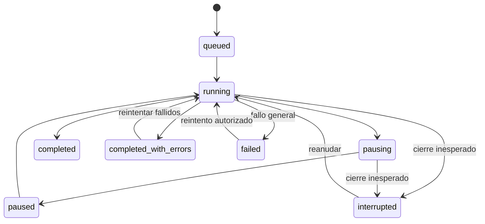
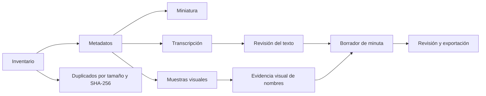

# Arquitectura de software — Videoteca Local

**Versión:** 1.1 · **Fecha:** 30 de octubre de 2026  
**Estado:** diseño propuesto para guiar la estabilización. No constituye una certificación del código actual ni una lista de funciones ya implementadas.  
**Prioridad:** aplicación local de Windows. La demo pública es una distribución independiente y secundaria.

## 1. Objetivo y alcance

Catalogar más de 1 TB de videos distribuidos entre carpetas locales, discos externos y, posteriormente, un NAS. Permitir encontrar contenido, detectar duplicados exactos, transcribir y preparar borradores de minutas con evidencia, conservando los originales y los resultados revisados por el usuario.

Equipo inicial: Windows 11 Pro, Intel i7-11850H, 32 GB de RAM y RTX A2000 de 4 GB. El volumen total de videos condiciona principalmente la lectura de los discos y el tiempo de procesamiento; no requiere cargar la biblioteca completa en memoria.

La primera versión estable será de un usuario y una computadora. No incluirá reorganización física automática, eliminación de duplicados, reconocimiento de identidad por caras o voces, colaboración multiusuario ni procesamiento público de YouTube.

**Solidez significa:** proteger los datos, recuperar trabajos, acotar los fallos de herramientas, explicar el estado real y poder verificar cada versión. No significa garantizar que un modelo reconozca o interprete todo correctamente.

## 2. Punto de partida comprobado (diagnóstico inicial)

La versión publicada que sirve de referencia es el commit `bcf87164c4500765c60b0f8d28e3a469d4a0fb27` del repositorio `CintiaCapece/videoteca-local`.

| Componente actual | Responsabilidad actual | Observación de arquitectura |
|---|---|---|
| `public/` | Interfaz del catálogo, selección, revisión y seguimiento | Depende de la API local; no debe ejecutar operaciones de disco por su cuenta. |
| `server.js` | Servidor HTTP, validaciones y consultas SQLite | Mezcla transporte, reglas de negocio y persistencia. |
| `lib.js` | Inventario, trabajos, herramientas y procesamiento | Concentra responsabilidades que deben separarse gradualmente. |
| SQLite en `datos/` | Fuentes, videos, trabajos, eventos y resultados | Hay persistencia, pero falta un registro durable de finalización por elemento de trabajo. |
| FFmpeg / ffprobe | Lectura técnica y extracción de imágenes | Procesos externos que pueden fallar, bloquearse o ser cancelados. |
| Python / faster-whisper | Reconocimiento de audio | Proceso separado; produce JSON y mensajes de progreso. |
| Ollama y auxiliares de IA | Descripciones visuales y minutas | Servicio local; una respuesta válida en formato no garantiza exactitud semántica. |
| Scripts PowerShell y CMD | Inicio, instalación y empaquetado | Forman parte del producto y necesitan pruebas de Windows. |
| `docs/` | Presentación y demo de GitHub Pages | Entorno estático con restricciones diferentes a la aplicación local. |

Riesgos concretos observados al leer el código publicado:

- La reanudación vuelve a construir los lotes. Una retranscripción con reemplazo o una minuta puede repetir videos ya completados porque no hay confirmación persistente por elemento.
- La apertura del catálogo marca trabajos activos como interrumpidos sin demostrar antes que no existe otra instancia legítima usando esa base.
- La pausa no tiene un contrato uniforme: algunos pasos comprueban la solicitud entre operaciones y una transcripción puede continuar hasta terminar el archivo.
- No existe un mecanismo de respaldo consistente integrado en el flujo de migración del esquema.
- Varias operaciones verifican el archivo antes de procesarlo, pero falta una regla común para rechazar resultados si el archivo cambió durante el procesamiento.

El diagnóstico inicial se mantuvo separado del código publicado. La evolución y la evidencia de cada incremento se registran en el [registro ADR](docs/adr/README.md). La versión 1.1.0 incorpora el incremento A y 1.2.0 incorpora el lote durable del incremento B, documentado en [ADR-0003](docs/adr/0003-recuperacion-por-video.md). La versión 1.3.0 agrega pausa de herramientas y cierre seguro según [ADR-0004](docs/adr/0004-pausa-y-cierre-seguro.md), con límites explícitos de cancelación remota. Los demás incrementos siguen siendo diseño objetivo. [ADR-0001](docs/adr/0001-base-tecnologica.md) confirma Node.js, procesos Python y frontend JavaScript modular. [ADR-0002](docs/adr/0002-proteccion-catalogo.md) documenta la protección del catálogo.

## 3. Decisión principal: monolito modular local

Se mantendrá un único servidor local Node.js y una única base SQLite. Los módulos tendrán límites explícitos y los procesos pesados seguirán ejecutándose fuera del hilo principal cuando corresponda.

No se incorporarán microservicios, un servidor de base de datos externo, una cola distribuida ni infraestructura de nube para resolver necesidades de una sola computadora. La separación será por responsabilidades y contratos verificables.



### Responsabilidades y límites

| Módulo propuesto | Hace | Límite obligatorio |
|---|---|---|
| `domain/` | Define entidades, estados, revisiones y reglas de validación | No conoce HTTP, SQLite, FFmpeg ni el navegador. |
| `application/catalog/` | Coordina fuentes, inventario, búsqueda y actualización de ubicación | Nunca mueve ni elimina originales. |
| `application/jobs/` | Planifica, ejecuta, pausa, reanuda y registra trabajos | Decide el estado; una herramienta no modifica directamente el catálogo. |
| `application/review/` | Gestiona correcciones, aprobación y resultados vigentes | Separa un borrador automático de una corrección humana. |
| `application/recovery/` | Coordina migraciones, respaldos y diagnóstico | No repara ni sobrescribe silenciosamente una base dañada. |
| `infrastructure/sqlite/` | Repositorios, transacciones, migraciones y exclusión de instancia | Encapsula el SQL y ofrece operaciones atómicas de negocio. |
| `infrastructure/files/` | Resuelve ubicaciones, comprueba revisiones y administra temporales propios | Verifica contención real y evita seguir enlaces fuera de la fuente. |
| `infrastructure/tools/` | Ejecuta herramientas con límites y cancelación | Devuelve resultados tipados; no accede directamente a SQLite. |
| `interfaces/http/` | Valida solicitudes y traduce respuestas y errores | No contiene el procesamiento ni reglas de reanudación. |
| `public/` | Presenta selección, estado, errores y revisión | No deduce éxito a partir de un porcentaje o un proceso terminado. |

Estructura objetivo orientativa:

```text
src/
  domain/
  application/
    catalog/
    jobs/
    review/
    recovery/
  infrastructure/
    sqlite/
      migrations/
      repositories/
    files/
    tools/
  interfaces/http/
public/
workers/python/
scripts/windows/
test/
  unit/
  integration/
  recovery/
  fixtures/
docs/
```

Esta estructura se alcanzará mediante extracciones pequeñas. No se requiere mover todos los archivos antes de corregir un fallo. Los puntos de entrada actuales pueden conservarse como adaptadores de compatibilidad.

## 4. Modelo de datos y trazabilidad

| Entidad | Información principal | Regla de consistencia |
|---|---|---|
| Fuente | Identidad, nombre, ubicación actual, estado y último inventario completo | Un disco desconectado conserva su identidad y su catálogo. |
| Video | Identidad, fuente y ruta relativa, clasificación manual | El identificador no depende de la letra actual del disco. |
| Revisión de archivo | Tamaño, modificación y, cuando se calcula, hash de contenido | Tamaño y fecha son indicadores; un hash completo confirma igualdad de bytes. |
| Resultado de etapa | Tipo, revisión de entrada, configuración, herramienta/modelo y versión del procesamiento | Un resultado anterior puede conservarse como histórico sin presentarse como vigente. |
| Transcripción | Texto, segmentos, modelo, parámetros y señales de revisión | La edición humana crea una nueva revisión del texto. |
| Minuta | Apartados, citas, referencias temporales y revisiones utilizadas | Una corrección de la transcripción vuelve obsoleta la minuta previa. |
| Trabajo | Tipo, parámetros congelados, estado y fechas | Reanudar no cambia silenciosamente los videos seleccionados. |
| Elemento de trabajo | Video, revisión, etapa, estado, intentos y error | Es la unidad mínima de finalización y reintento. |
| Evento | Trabajo, elemento, código, fase y mensaje | Permite explicar fallos sin registrar indiscriminadamente el contenido del video. |
| Respaldo | Fecha, versión del esquema, ubicación e integridad comprobada | Copia consistente que puede probarse en una restauración aislada. |

### Revisión e idempotencia

Cada ejecución tendrá una clave basada en: video + revisión de entrada + etapa + configuración + versión del procesamiento. Una corrección manual se identifica por su propia revisión.

La aplicación podrá repetir un cálculo después de una caída. Lo que debe impedir es guardar dos resultados vigentes incompatibles o reprocesar un elemento que ya confirmó correctamente. **No se prometerá ejecución exactamente una vez de procesos externos:** se garantizará confirmación atómica e idempotente de resultados dentro del catálogo.

Los cambios de contenido invalidan los análisis derivados de esa revisión, pero no eliminan etiquetas, notas ni decisiones manuales del usuario. La migración hacia un historial de resultados debe preservar los datos actuales y distinguir resultado histórico de resultado vigente.

## 5. Motor de trabajos y recuperación

### Plan durable

Al aceptar un trabajo se guardarán su selección y configuración. La planificación registrará sus elementos antes de procesarlos. Las exclusiones —sin audio, ya completado, ausente— se comunicarán; no se sustituirán por otros videos.

Cada elemento tendrá estados `pending`, `running`, `succeeded`, `failed` o `cancelled`. Un fallo reintentable conserva el error y el número de intentos. El progreso de lote se calcula desde estos registros y distingue completados, fallidos y pendientes.



### Confirmación de un resultado

1. Reservar el elemento y registrar el intento.
2. Comprobar disponibilidad, pertenencia a la fuente y revisión de entrada.
3. Ejecutar la herramienta fuera de una transacción larga de SQLite.
4. Validar la estructura del resultado y comprobar otra vez la revisión de entrada.
5. Guardar el resultado vigente y marcar el elemento como completado **en una sola transacción corta**.
6. Publicar el progreso derivado de los registros confirmados.

Nunca se mantendrá una transacción de escritura abierta mientras trabaja Whisper, FFmpeg u Ollama. Los archivos auxiliares se escriben primero como temporales propios y se publican mediante renombrado. Una caída entre el archivo auxiliar y la transacción puede dejar un huérfano recuperable en la caché, pero no debe reemplazar un resultado confirmado por un archivo incompleto.

### Semántica de pausa, cierre y reintento

- **Pausar:** solicitar cancelación de la operación actual y detener el avance. Los videos confirmados quedan terminados; el video o etapa no confirmados vuelven a pendientes. La interfaz muestra “Deteniendo” hasta completar este paso.
- **Cerrar normalmente:** dejar de aceptar trabajos nuevos, solicitar detención, esperar el cierre de procesos propios dentro de un plazo y cerrar el catálogo. Si no se alcanza el cierre ordenado, se aplicará la recuperación de interrupción en el siguiente inicio.
- **Caída o apagado:** al reiniciar y después de asegurar una única instancia, convertir elementos en ejecución a pendientes recuperables. No declarar terminada una operación solo por encontrar un archivo temporal.
- **Reanudar:** ejecutar únicamente elementos pendientes y fallidos del plan guardado. No repetir los confirmados, incluso al reemplazar una transcripción o regenerar una minuta.
- **Reintentar:** usar el mismo plan y parámetros. Cambiar de modelo o de selección constituye un trabajo nuevo y queda registrado.
- **Versión anterior:** los trabajos históricos que no tengan confirmación por elemento requieren un tratamiento de compatibilidad explícito; no puede afirmarse que sus elementos ya procesados sean identificables con certeza.

Los tiempos de espera se definen por adaptador y fase. El progreso distinguirá porcentaje medido, porcentaje por elementos y estado sin porcentaje. La estimación restante solo se mostrará cuando existan mediciones suficientes.

## 6. Procesamiento multimedia e IA

Flujo lógico, ejecutable por etapas independientes:



La transcripción y la clasificación visual no son intercambiables. Un resumen de cinco imágenes no representa el contenido completo de una reunión.

### Contrato de herramientas

Cada adaptador recibirá una entrada validada, configuración, señal de cancelación y receptor de progreso. Devolverá un resultado validado o un error tipado. Tendrá límites de tiempo, memoria/salida razonables y limpieza de sus temporales.

Errores mínimos: herramienta ausente, dependencia incompatible, modelo ausente, memoria insuficiente, fuente desconectada, archivo modificado, formato inválido, tiempo agotado y cancelación. Un error de un video no debe detener el resto del lote cuando estos puedan procesarse de forma segura.

La detección de herramientas diferencia **ejecutable encontrado**, **dependencias importables**, **modelo disponible** y **prueba funcional superada**. Un indicador verde de instalación no demuestra por sí solo que un modelo pueda procesar un video.

### Política de recursos inicial

- Un trabajo de procesamiento pesado activo por vez; catálogo, revisión y búsqueda permanecen disponibles.
- Whisper en CPU como base compatible. Los perfiles más capaces y la GPU se habilitan después de comprobar memoria y dependencias con una prueba funcional.
- Ollama utiliza un modelo por vez y libera su carga cuando corresponde. La RTX de 4 GB no se considera capaz de mantener simultáneamente todos los modelos.
- Se registra duración de carga, extracción, reconocimiento y generación. El rendimiento se decide con mediciones, no por el nombre del modelo.
- No se fija una velocidad universal: depende de duración, códec, idioma, calidad de audio, CPU/GPU y ubicación del archivo.

### Calidad de minutas y participantes

- Ningún perfil se presentará como transcripción automáticamente exacta.
- El texto corregido por el usuario es una entrada versionada y preferente para la minuta.
- Cada punto de la minuta conserva referencias a la revisión del texto o a la muestra visual que lo originó.
- Los nombres solo proceden de lo dicho/transcrito o de nombres legibles en pantalla. No se identifican personas mediante su cara o voz.
- Se separan nombres visibles, nombres mencionados y asistencia confirmada por el usuario. Una mención no demuestra participación.
- Las citas literales verifican procedencia textual, no la verdad de lo reconocido ni la interpretación del modelo. Una lectura visual automática también puede equivocarse.
- Una propuesta no se convierte en decisión; responsables y plazos solo se incluyen cuando la evidencia los expresa.
- Una respuesta truncada o inválida no reemplaza la transcripción ni la minuta anterior.
- Los fragmentos deben cubrir toda la entrada, incluso si un párrafo es muy largo. Se validará que ningún corte o límite de contexto produzca una omisión silenciosa.
- Texto y pantalla se tratan como datos sin autoridad para ejecutar instrucciones, abrir rutas, modificar archivos o cambiar la configuración.

La evaluación de calidad utiliza grabaciones de prueba autorizadas con transcripción y minuta revisadas por una persona. Se medirán errores de reconocimiento, recuperación de temas, decisiones y tareas, nombres sin respaldo y correcciones necesarias. El material sintético prueba integración; no sustituye la evaluación de reuniones reales.

## 7. Persistencia, seguridad y recuperación del catálogo

### Ubicación y propiedad

Se propone separar tres ubicaciones configurables:

| Ubicación | Contenido | Recomendación inicial |
|---|---|---|
| Aplicación | Código y scripts | Carpeta de instalación o repositorio. |
| Datos del usuario | SQLite, respaldos, configuración y resultados revisados | Disco local fuera de carpetas sincronizadas; por ejemplo `%LOCALAPPDATA%/VideotecaLocal`. |
| Caché | Modelos, miniaturas regenerables y temporales | Carpeta local con espacio suficiente y posibilidad de reubicación. |

La separación es un objetivo, no una migración ya realizada. **No se moverán los datos actuales automáticamente** sin un procedimiento verificado de respaldo, copia, comprobación y posibilidad de volver a la ubicación anterior.

SQLite permanecerá en el disco local aunque los videos se encuentren en un NAS. Sincronizar o copiar archivos de una base abierta como si fueran documentos comunes no es el mecanismo de respaldo.

### Exclusión de instancia

Antes de migrar o recuperar trabajos, la aplicación debe demostrar que posee el catálogo de forma exclusiva. Dos servidores con el mismo directorio de datos no pueden procesar ese catálogo a la vez, aunque escuchen en puertos diferentes.

La adquisición y recuperación de propiedad debe ser atómica y tolerar caídas. Ante propiedad dudosa se rechaza el segundo inicio con un mensaje claro; no se manipulan trabajos ajenos. Un identificador de proceso reutilizado puede justificar un rechazo conservador, nunca una apropiación insegura.

### Migraciones y respaldos

1. Asegurar la propiedad exclusiva.
2. Comprobar integridad y versión del esquema; rechazar un esquema más nuevo que el soportado.
3. Crear un respaldo SQLite consistente antes de modificar un catálogo existente.
4. Aplicar la migración dentro de una transacción corta, con reversión completa ante error.
5. Registrar versión y resultado; recién entonces recuperar trabajos interrumpidos.

El respaldo usará un mecanismo consistente de SQLite —API de backup o `VACUUM INTO`—, no una copia aislada del archivo principal con escrituras activas. Incluirá un manifiesto de versión y comprobación de integridad. Los originales no forman parte del respaldo del catálogo; los modelos y miniaturas regenerables tienen una política separada.

La restauración se probará en un directorio nuevo y con la aplicación detenida. Se verifica integridad, cantidad de fuentes/videos y presencia de clasificaciones, transcripciones y minutas. El catálogo anterior se conserva para volver atrás. Exportar JSON/CSV facilita consulta e intercambio; no equivale automáticamente a un respaldo restaurable.

### Controles de acceso y archivos

- Escuchar solo en `127.0.0.1` por defecto, con validación de Host, origen y protección de escrituras desde otras páginas.
- Ninguna credencial ni token se incluye en GitHub, los paquetes o registros de diagnóstico.
- Resolver rutas desde fuentes autorizadas, comprobar contención real y bloquear escapes mediante enlaces/junctions.
- No ejecutar órdenes construidas con nombres de archivos. Pasar argumentos al proceso sin intérprete de comandos.
- Solo limpiar temporales y cachés identificados como propiedad de la aplicación; nunca originales ni carpetas calculadas sin verificar su destino.
- Los registros técnicos incluyen códigos, fases y tiempos; transcripciones, imágenes y audio no se registran indiscriminadamente.

## 8. API e interfaz

Las rutas existentes se mantendrán mediante adaptadores mientras sea posible. Si cambia un contrato de forma incompatible, se introducirá una versión explícita. No es necesario renombrar todas las rutas para estabilizar la app.

| Operación | Contrato esperado |
|---|---|
| Crear trabajo | Validación de selección/configuración; aceptación con identificador durable. |
| Consultar trabajo | Estado, fases, total planificado, confirmados, fallidos, pendientes y última actualización. |
| Pausar/reanudar | Operaciones explícitas; respuesta coherente si ya se pidió la misma acción. |
| Consultar incidencias | Errores del trabajo y elemento concretos, con orientación para reintento. |
| Corregir transcripción | Nueva revisión; conflicto si intenta sobrescribir una revisión que cambió mientras estaba abierta. |
| Consultar herramientas | Diagnóstico por componente con estado y motivo, sin confundir ausencia con fallo funcional. |
| Crear respaldo | Resultado verificable: identificador, fecha, tamaño y ubicación. |

La API distinguirá validación incorrecta, recurso inexistente, conflicto de estado y fallo de herramienta. La interfaz debe recuperar sus botones tras un fallo, indicar desconexión y evitar doble envío. Un corte de la conexión HTTP no se interpretará como cancelación del trabajo: al reconectar se consulta su estado persistido.

## 9. Discos externos y NAS

Una fuente es una identidad con ubicación reemplazable, no una letra de unidad permanente. El catálogo conserva rutas relativas y el estado de disponibilidad.

- Un inventario solo marca ausencias cuando pudo recorrer la fuente de manera completa. Un error de permisos o desconexión no equivale a borrar videos del catálogo.
- Si cambia la ubicación, se verifican correspondencias y revisión de archivos antes de reutilizar resultados. Verificar cinco archivos no demuestra por sí solo identidad de toda la biblioteca.
- El acceso a NAS se implementa a través del mismo adaptador de archivos y fuentes SMB/UNC. El coordinador y la base de datos permanecen locales.
- El procesamiento puede leer directamente de la fuente. Copiar previamente un video a caché sería una opción explícita, sujeta a espacio disponible y verificación, no el comportamiento inicial.
- Multiequipo, varios escritores y procesamiento distribuido quedan fuera de esta versión; requerirían revisar persistencia, autorización y coordinación.

Elegir o comprar un NAS es una decisión posterior. Esta arquitectura no depende de una marca ni exige adquirir hardware para estabilizar la app actual.

## 10. Pruebas y criterios de salida

### Capas de comprobación

| Capa | Qué demuestra |
|---|---|
| Unitaria | Transiciones, selección, invalidación, validación de resultados y construcción de planes. |
| Integración | Transacciones SQLite, migraciones, rutas, API y protocolos de procesos. |
| Recuperación con fallos provocados | Cierre forzado, cancelación, desconexión, archivo modificado, salida inválida y reanudación. |
| Herramientas reales | Instalación funcional y procesamiento real de una muestra pequeña en Windows. |
| Evaluación de IA | Calidad sobre material autorizado con referencia humana, separada de las pruebas técnicas. |
| Empaquetado y actualización | Instalación desde el ZIP publicado, archivos necesarios y conservación de datos al actualizar. |

### Puerta de salida para la primera versión estable local

Todos los siguientes criterios deben tener evidencia reproducible:

1. Ninguna prueba modifica, mueve o elimina un original; se verifican hashes antes y después en las pruebas relevantes.
2. Un segundo inicio con el mismo catálogo es rechazado sin cambiar trabajos ni datos de la primera instancia.
3. Un cierre forzado durante el segundo video de un lote no repite el primero confirmado al reanudar, incluso en retranscripciones con reemplazo y minutas.
4. Un archivo modificado durante el análisis no recibe resultados basados en la revisión anterior como si fueran actuales.
5. Una cancelación deja el estado recuperable y permite iniciar o reanudar sin que el proceso anterior siga guardando resultados.
6. Una herramienta ausente, un modelo sin memoria, una respuesta inválida o un disco desconectado producen un error comprensible y no destruyen resultados previos.
7. Una migración fallida revierte sus cambios y conserva un respaldo consistente. Se demuestra restauración en un directorio separado.
8. Corregir una transcripción preserva su revisión y vuelve obsoletas las minutas derivadas; no hay pérdida silenciosa por una edición concurrente.
9. El lote usa exactamente su plan guardado y distingue elementos confirmados, fallidos y pendientes.
10. El paquete descargable pasa las comprobaciones en Windows desde una carpeta limpia y no contiene datos personales, modelos ni entornos privados.
11. Las funciones de IA publicadas como compatibles cuentan con prueba funcional en el equipo objetivo. Las no verificadas permanecen identificadas como tales.
12. El piloto de reuniones reales documenta limitaciones y correcciones necesarias. Pasar pruebas de código no autoriza afirmar que las minutas son exactas.

No se considerará suficiente “pasaron N pruebas”: cada criterio indica qué fallo se provocó, qué se esperaba y qué ocurrió. Los criterios de calidad de IA se acordarán con muestras reales; no se inventarán porcentajes de precisión sin referencia humana.

## 11. Implementación por incrementos

| Incremento | Resultado verificable | Dependencia |
|---|---|---|
| A. Protección del catálogo | Exclusión de instancia, versión de esquema, migración transaccional, respaldo y restauración probados | Primer paso. |
| B. Trabajos recuperables | Plan durable, confirmación por elemento, reintentos y preservación de resultados | A. |
| C. Herramientas controladas | Cancelación uniforme, tiempos de espera, validación de entradas/salidas y diagnóstico | B, con adaptadores extraídos gradualmente. |
| D. Resultados y revisión | Revisiones de archivo/texto, comprobación antes de confirmar e invalidación trazable | A–C. |
| E. Calidad de reuniones | Piloto con referencia humana, perfiles medidos y minutas con evidencia revisable | D. |
| F. Distribución estable | Actualización conservando datos, comprobación del ZIP y guía de recuperación | A–E. |

Cada incremento será pequeño, revisable y acompañado por pruebas que reproduzcan el fallo correspondiente. No se acumulará una reescritura completa antes de verificar los fundamentos.

## 12. Decisiones y consecuencias

| Decisión | Motivo | Consecuencia o límite |
|---|---|---|
| Monolito modular y SQLite local | Encaja con una computadora y reduce dependencias operativas | No ofrece escritura concurrente desde varios equipos. |
| Un solo coordinador pesado | Evita competencia de RAM, GPU y disco | El rendimiento de lotes se mejora por medición y selección de etapas, no por paralelismo indiscriminado. |
| Originales de solo lectura | Hace reversible el uso normal del catálogo | La organización física se diseña aparte y no se incorpora silenciosamente. |
| Resultados versionados y confirmación atómica | Permite reintento y revisión sin sobrescrituras ambiguas | Requiere migraciones y reglas de vigencia explícitas. |
| IA como resultado revisable | La exactitud no está garantizada | La revisión humana sigue siendo parte del flujo. |
| Demo web separada | El navegador tiene otras restricciones de memoria y ejecución | Una limitación de la demo no redefine el contrato de la app local. |
| Sin nube en la ruta local por defecto | Mantiene privacidad y operación sin costos de alojamiento | Descargas iniciales requieren conexión; cualquier integración externa futura se diseña de forma explícita. |

La solidez se evaluará por recuperación demostrada, preservación de datos y calidad medida. La cantidad de agentes, archivos de instrucciones o herramientas no reemplaza esos resultados.

